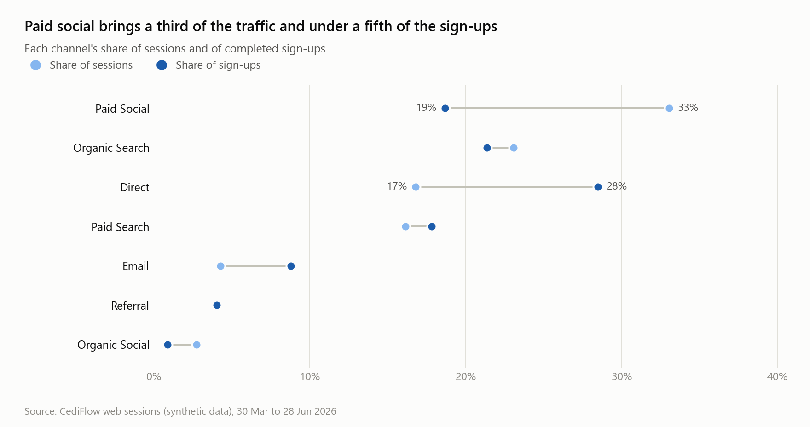
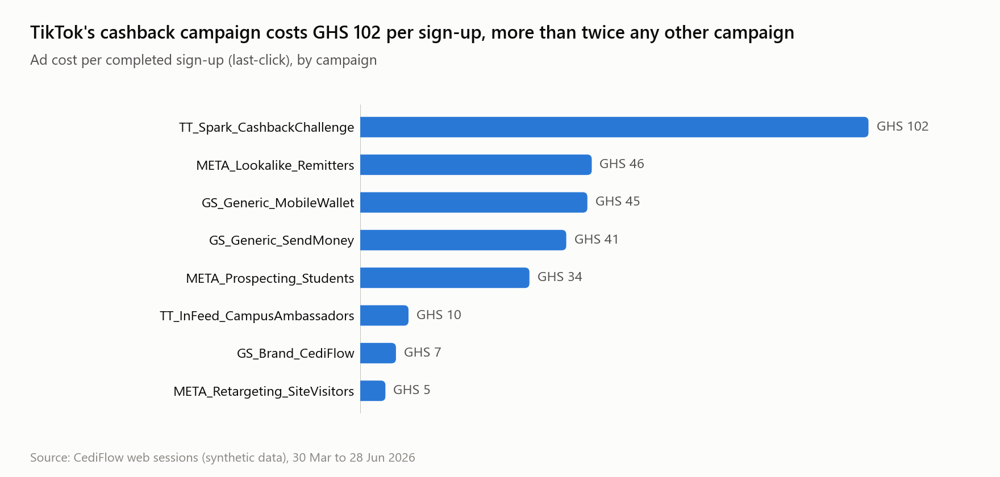
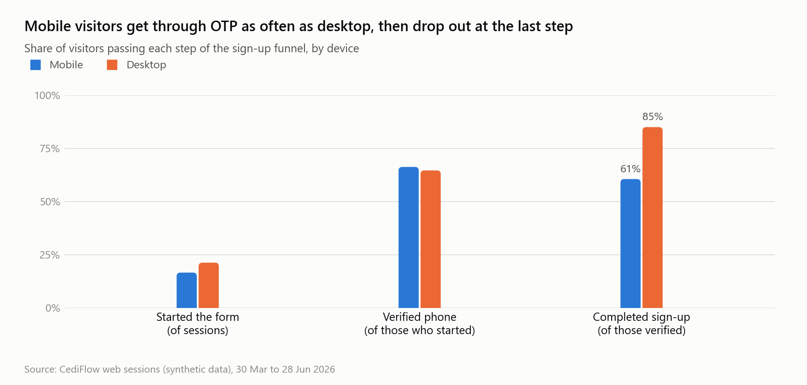
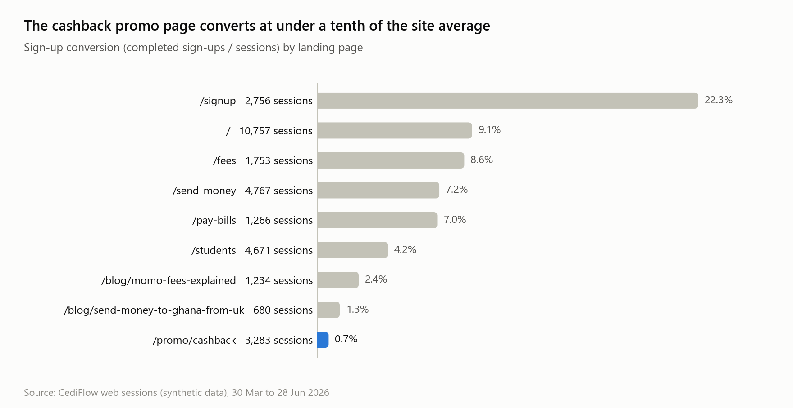
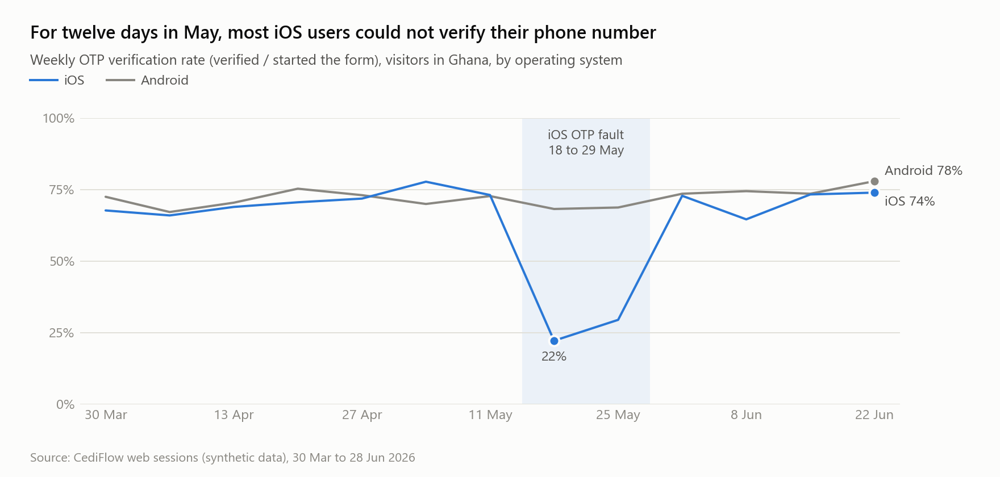

<!-- markdownlint-disable MD013 -->
# Project 1: Web & Acquisition Analytics

> **Status:** analysis, SQL, Python and report complete. The Tableau dashboard is still to be built; see [Dashboard](#dashboard).

CediFlow is a fictional Ghanaian mobile wallet. This project takes one quarter of its website data, as a raw GA4-style event export, and answers the question a head of growth would ask: **which traffic turns into sign-ups, and where is the rest being lost?**

The short answer: most of the sign-ups CediFlow could add next quarter are ones it is already paying for. One mobile form step, one landing page and one mistargeted campaign account for most of the loss. The one-page version is in the [executive insights report](executive-insights-report.md).

## Business questions

1. Which channels and campaigns bring visitors who sign up, and what does a sign-up cost in each?
2. Where in the sign-up funnel do visitors drop out, and for whom?
3. Which landing pages turn a visit into a sign-up, and which waste the traffic sent to them?
4. Is any ad spend going to visitors who cannot become customers?
5. Did anything break during the quarter that the headline numbers hid?

## Methodology

**Data.** Synthetic, generated for this project to behave like a real GA4 export. 13 weeks, 30 March to 28 June 2026: 123,435 raw events and 671 rows of ad-platform cost. Tables, columns and definitions are in the [data dictionary](data/data_dictionary.md).

**Cleaning** ([python/01_clean_and_model.py](python/01_clean_and_model.py)). The raw export had ten separate problems. The ones that changed the answers:

| Problem | What was done | Effect |
| --- | --- | --- |
| Events fired twice | Exact duplicates removed | 1,818 rows, 36 of them sign-up events |
| Two bots and internal QA traffic | Identified by behaviour and removed | 2,202 sessions (6.6% of the total) and 123 fake sign-ups |
| Inconsistent traffic labels (`fb`, `Facebook`, `facebook.com`) | Mapped to one standard label each | Campaign names fell from 31 variants to 11 |
| Session IDs shared between visitors | Sessions keyed on visitor and session ID together | 102 sessions kept separate |

Counting sign-up events in the raw file gives 2,585. The real figure is 2,426. Uncleaned, the Direct channel's conversion rate reads 10.95%; cleaned, it is 13.20%.

**Modelling.** GA4 exports events, not sessions. Sessions were rebuilt from events, each with its landing page, its channel (GA4's default channel grouping) and how far it got through the four-step funnel: session → started the form → verified phone by OTP → completed sign-up.

**Analysis.** One table per business question, built in pandas ([python/02_analysis.py](python/02_analysis.py)) and again in SQL ([sql/](sql/README.md)). Each comparison a finding rests on has a two-proportion z-test and a 95% interval. Where an average could be hiding a change in mix, the comparison is repeated inside each group.

**Checks.** Three independent ones, all passing:

- The SQL query that rebuilds sessions from events returns the same 31,167 rows as the Python pipeline.
- All eleven SQL results match the pandas tables ([python/03_verify_sql_against_python.py](python/03_verify_sql_against_python.py)).
- Because the data is generated, the cleaned sessions could be compared with the generator's ground truth: every real session kept, every bot and test session removed.

**Tools.** Python 3.10 (pandas, matplotlib), SQLite, Tableau Public.

**To reproduce:** install [requirements.txt](requirements.txt), then run the three scripts in [python/](python/README.md) in order.

## Key findings

The quarter: **31,167 sessions, 2,426 sign-ups, 7.8% conversion.** GHS 22,218 of ad spend bought 885 sign-ups at GHS 25.11 each.

### 1. Paid social brings 33% of sessions and 19% of sign-ups, but the channel average hides a twenty-fold spread

Direct and email are the reverse: 21% of sessions, 37% of sign-ups. Paid social's clicks are cheap enough that it still costs less per sign-up than paid search (GHS 21.90 against GHS 28.47). The real story is inside the channels: cost per sign-up runs from GHS 5 to GHS 102 by campaign.





### 2. The biggest fixable leak is the last form step on mobile: 61% complete it, against 85% on desktop

Mobile and desktop visitors start the form and pass OTP at similar rates. The gap opens only at the details form: 24 points (95% interval 21 to 27). Mobile is 77% of traffic, and 1,045 mobile sessions got as far as a verified phone and ended without a sign-up.



### 3. `/promo/cashback` converts at 0.7%, against 8.6% for the rest of the site

It takes 11% of all sessions. It is the page, not the audience: inside each channel that sends traffic to it, visitors who land there convert far worse than visitors who land elsewhere (email: 2.9% against 18.8%; paid social: 0.4% against 5.9%). TikTok's Spark campaign sends all its traffic to it, which is why GHS 1,220 bought 12 sign-ups while TikTok's other campaign pays GHS 9.70 each.



### 4. 39% of one Meta campaign's clicks come from countries where sign-up is impossible

META_Lookalike_Remitters reaches Ghanaians in the UK and US. Sign-up needs a Ghanaian phone number, so 626 sessions from abroad produced 5 sign-ups, on about GHS 1,200 of the campaign's GHS 3,106. Across all channels, 390 sessions from abroad started the form, at the same rate as sessions in Ghana, and 380 of them ended without a sign-up.

### 5. iOS phone verification failed for 12 days in May, and the topline barely showed it

From 18 to 29 May, 21% of iOS visitors in Ghana passed the OTP step, against 71% the rest of the quarter. Android was unaffected. About 38 sign-ups were lost, 11% of what those days should have produced. Site-wide conversion dipped from 7.7% to 6.5%, small enough to be put down to campaign mix.



**Also worth knowing.** Ashanti converts at 10.6% against Greater Accra's 7.7%, and still at 10.2% once its channel mix is matched to Accra's, yet it receives 15% of paid traffic against Accra's 56%. And 54% of all sign-ups happen on a return visit, which matters for how much credit last-click gives to Direct and retargeting.

## Dashboard

**Not built yet.** The charts above were drawn in Python from the same tables. The Tableau dashboard has five sections, each answering one question:

| Section | Question it answers |
| --- | --- |
| Executive Summary | How much traffic did the site get, how much signed up, and what did the paid part cost? |
| Acquisition Analysis | Which channels and campaigns bring visitors who sign up, and at what cost? |
| Funnel Analysis | Where do visitors drop out of the sign-up funnel, and for whom? |
| User Behavior | Which landing pages turn a visit into a sign-up? |
| Drilldown | What is behind a number that looks wrong? |

The [build guide](tableau/dashboard_build_guide.md) has the data connection, every calculated field, LOD expression and parameter, and the figures each section must match. Screenshots and the Tableau Public link go here once it is published.

## Recommendations

| | Action | Finding | Expected change |
| --- | --- | --- | --- |
| 1 | Rework the sign-up details form for mobile, starting with field-level tracking to find where people stop | 2 | Closing half the gap to desktop adds about 320 sign-ups a quarter (+13%) with no media spend |
| 2 | Pause TT_Spark_CashbackChallenge until `/promo/cashback` is fixed; send its traffic to `/students` or move the budget to the campus campaign | 3 | At half the campus campaign's conversion rate, about 70 sign-ups for the same GHS 1,220 instead of 12 |
| 3 | Restrict META_Lookalike_Remitters to Ghana, and add a waitlist for non-Ghanaian numbers to measure diaspora demand | 4 | About GHS 1,200 a quarter recovered; cost per sign-up from GHS 46 to about GHS 31 |
| 4 | Alert on each funnel step by operating system: a 3-day rate against its 4-week baseline | 5 | The May fault would have been flagged on day 3; it ran for 12 |
| 5 | Run a four-week test shifting part of one campaign's budget from Greater Accra to Ashanti | Also worth knowing | A lower cost per sign-up if Ashanti's advantage holds for paid traffic. A test, not a certainty |

## Limitations

- **A sign-up is not a customer.** The data ends at the form. It cannot say which channel's sign-ups go on to verify their identity or transact, so a campaign that looks cheap here could still be poor value.
- **Attribution is last-click.** Retargeting (GHS 5 per sign-up) and brand search (GHS 7) reach people who were already on their way, so their true cost per *additional* sign-up is higher than shown.
- **The data shows where visitors leave, not why.** The mobile form and the cashback page are diagnosed by comparison. The cause needs field-level tracking, session recordings or a test.
- **The expected changes are estimates.** Each assumes the fixed page or form would perform like the comparison group. Only an A/B test confirms that.
- **Campaign cost per sign-up is slightly overstated.** 406 paid sessions (2.6%) arrived without a campaign tag, carrying 25 sign-ups that no campaign is credited with.
- **Spend abroad is estimated** from the share of sessions, because cost is not reported by country. Clicks from the UK and US probably cost more than Ghanaian ones, so GHS 1,200 is likely an underestimate.
- **The data is synthetic.** The methods transfer to real data; the numbers are not benchmarks.

## What is in this folder

```text
data/       raw export, cleaned tables, data dictionary
python/     cleaning, analysis and verification scripts; output tables and charts
sql/        eleven queries, one per question, with saved results
tableau/    dashboard build guide (workbook and screenshots to come)
executive-insights-report.md
```
